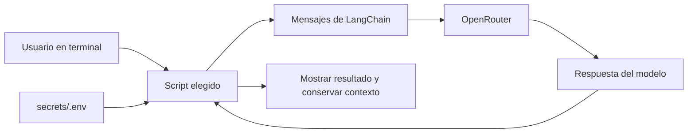

# Diplomado en Agéntica Aplicada · Sesión 1

Universidad de La Sabana · 2026-II.

Primera conexión de Python con un modelo de lenguaje mediante LangChain y
OpenRouter. La sesión comienza con tres scripts independientes: un chat básico,
un flujo de tres llamadas y un debate entre dos posturas del mismo modelo.

## Preparar el entorno

Desde la raíz del repositorio, crea el entorno Conda:

```bash
conda env create -f environment.yaml
conda activate DiplomadoAgentica
python -m pip check
```

Si ya existe, actívalo con `conda activate DiplomadoAgentica`. Para actualizar sus
requisitos, ejecuta `conda env update -f environment.yaml` desde la raíz.
El YAML declara Python 3.12 y utiliza las versiones de `requirements.txt`.

## Configurar OpenRouter

Crea la carpeta `secrets` si no existe. Copia `.env.example` de la raíz a
`secrets/.env` **solo si todavía no tienes ese archivo**, para conservar tu configuración.
Completa sus dos variables:

```dotenv
OPENROUTER_API_KEY=TU_CLAVE
LLM_MODEL=IDENTIFICADOR_DEL_MODELO
```

Los tres scripts leen `secrets/.env` respecto a su propia ubicación. Las variables
ya definidas en el entorno tienen precedencia. `secrets/` está ignorado por Git;
no publiques credenciales. Las llamadas requieren conexión, un modelo disponible
en tu cuenta y pueden consumir saldo. Estos ejemplos no requieren tool calling.

## Ejecutar los ejemplos

Ejecuta cada script por separado:

```bash
python chat.py
python ChatThinking.py
python ChatVS.py
```

| Script | Qué hace | Llamadas previstas |
|---|---|---|
| `chat.py` | Responde a cada pregunta y conserva opcionalmente la conversación. | Una por pregunta válida. |
| `ChatThinking.py` | Genera un resumen del objetivo, un plan y una respuesta final. | Tres por pregunta válida. |
| `ChatVS.py` | Alterna argumentos a favor y en contra de un tema. | Cuatro por debate, según `NUM_TURNOS`. |

En los dos chats, escribe `salir` para terminar. Las entradas vacías se ignoran.
En el debate, introduce un tema y espera las intervenciones; una entrada vacía
termina sin llamar al modelo. Ctrl+C o Ctrl+D durante la lectura de entrada
permiten salir. Los fallos de configuración o del proveedor se propagan como
errores de Python; estos scripts todavía no incorporan recuperación de errores.

En PyCharm selecciona el intérprete de `DiplomadoAgentica` y ejecuta uno de los
tres archivos. En el equipo donde se preparó el entorno, el intérprete está en
`/opt/anaconda3/envs/DiplomadoAgentica/bin/python`.

## Cómo se procesa la solicitud

Los scripts son alternativas: una pregunta no pasa de un archivo a otro.
Cada uno carga las credenciales, crea su cliente `ChatOpenRouter`, prepara
mensajes y llama al modelo con `llm.invoke()`.



### `chat.py`: pregunta y respuesta

1. Carga `OPENROUTER_API_KEY` y `LLM_MODEL` desde `secrets/.env` y crea el cliente.
2. Define un `SystemMessage` que solicita respuestas claras y breves.
3. Lee la pregunta con `input()` y la convierte en un `HumanMessage`.
4. Construye la lista: instrucción + historial opcional + pregunta actual.
5. `llm.invoke(mensajes)` envía la conversación al modelo y devuelve un `AIMessage`.
6. Imprime `respuesta.content`. Si `USAR_MEMORIA = True`, guarda pregunta y respuesta
   en la lista `historial`, que se vuelve a enviar en el siguiente turno.

### `ChatThinking.py`: tres etapas conectadas

1. Carga la configuración, crea el cliente y lee una pregunta.
2. Primera llamada: solicita identificar el objetivo y las restricciones.
3. Segunda llamada: envía la pregunta y ese resumen para obtener un plan breve.
4. Tercera llamada: envía pregunta, resumen y plan para producir la respuesta final.
5. Imprime los tres resultados. Son textos generados mediante llamadas distintas;
   no representan acceso al razonamiento interno del modelo.
6. Si la memoria está activa, conserva únicamente la pregunta y la respuesta final
   para las siguientes preguntas. Las tres etapas reciben ese contexto previo.

### `ChatVS.py`: debate con posturas alternadas

1. Carga la configuración, crea el cliente y recibe un tema.
2. Define dos instrucciones de sistema: defender el tema y cuestionarlo.
3. Repite `NUM_TURNOS` intervenciones. `turno % 2` alterna la postura.
4. Envía al modelo la postura, el tema y los argumentos disponibles.
5. Imprime la respuesta con su rol y la guarda para la siguiente intervención.
6. Con memoria, reenvía todo el debate; sin memoria, solo el argumento anterior.
   El tema original siempre se incluye. Ambos participantes utilizan el mismo modelo.

## Activar o desactivar la memoria

Cada archivo contiene esta opción editable:

```python
USAR_MEMORIA = True
```

Cámbiala a `False` para comparar resultados:

- En `chat.py`, cada pregunta se envía sin turnos anteriores.
- En `ChatThinking.py`, se omiten conversaciones anteriores, pero se mantienen
  conectadas las tres etapas de la pregunta actual.
- En `ChatVS.py`, cada intervención recibe solo el argumento anterior y el tema.

El historial vive en listas de Python y se pierde al cerrar el programa. No hay
persistencia en archivos ni base de datos.

## Archivos del proyecto

```text
diplomado-sabana/
├── chat.py
├── ChatThinking.py
├── ChatVS.py
├── environment.yaml
├── requirements.txt
├── .env.example
├── .gitignore
├── README.md
├── data/
│   └── solicitudes.csv
└── secrets/                  # Configuración local, excluida de Git
    └── .env
```

| Archivo | Responsabilidad |
|---|---|
| `chat.py` | Chat de terminal con memoria opcional. |
| `ChatThinking.py` | Flujo explícito de resumen, planificación y respuesta. |
| `ChatVS.py` | Debate de dos posturas con un número configurable de intervenciones. |
| `environment.yaml` | Crear el entorno Conda `DiplomadoAgentica`. |
| `requirements.txt` | Fijar las dependencias Python del entorno. |
| `.env.example` | Plantilla de configuración sin claves reales. |
| `secrets/.env` | Configuración privada que leen los tres scripts. |
| `.gitignore` | Excluir secretos, cachés y archivos locales de Git. |
| `data/solicitudes.csv` | Datos sintéticos conservados para ejercicios posteriores; los chats no los consultan. |
| `README.md` | Instalación, ejecución y explicación de los flujos. |

Las carpetas `ai/` y `tests/` se retiraron para comenzar con ejemplos sencillos.
Por ahora no hay herramientas, agentes con selección de acciones, RAG, backend
ni interfaz web. Las dependencias se conservan para la continuidad del curso.

## Práctica sugerida

1. Ejecuta `chat.py`, menciona un código de solicitud y pregunta después qué código
   mencionaste. Compara con `USAR_MEMORIA = False`.
2. Ejecuta `ChatThinking.py` con una tarea breve y observa los tres resultados.
3. Ejecuta `ChatVS.py` con un tema de discusión. Cambia `NUM_TURNOS` y compara el
   debate con y sin memoria.

La verificación local de los scripts se realizó con respuestas simuladas, sin
consumir la API: conversación con historial, tres llamadas del flujo Thinking,
cuatro intervenciones del debate y salida por cierre de entrada. No se incluye
una suite de pruebas ni se ha verificado aquí una conversación real con OpenRouter.
